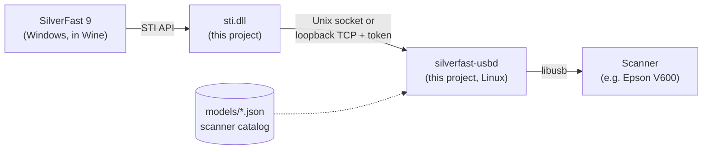

<div align="center">

# silverfast-linux

**Run SilverFast 9 on Linux and scan with your USB scanner — no Windows VM required.**

[](https://github.com/sepgh/silverfast-linux/actions/workflows/ci.yml)


[](LICENSE)
[](https://github.com/sepgh/silverfast-linux/releases/latest)

[Quick start](#quick-start) · [How it works](#how-it-works) · [Troubleshooting](#troubleshooting) · [Roadmap](#roadmap) · [Docs](docs/)

</div>

---

[SilverFast](https://www.silverfast.com) is LaserSoft Imaging's scanner
software, popular for film and photo scanning. It is only available for
Windows and macOS. silverfast-linux runs the **Windows build of SilverFast 9
under Wine** and supplies the two pieces Wine is missing to reach a scanner: a
working Windows still-image layer (`sti.dll`) and a small Linux helper that
talks to the scanner over USB. Scanners are described as data in a
[scanner catalog](models/), so any scanner SilverFast supports through the
standard Windows scanner stack can be added without code.

The **Epson Perfection V600** is the reference scanner: everything is
developed and tested on it, and it works end to end.

> [!NOTE]
> This is an unofficial community project. It is not affiliated with or
> endorsed by LaserSoft Imaging or Seiko Epson. You need your own SilverFast
> licence (MySilverFast account); nothing from either vendor is included in
> this repository — the installer downloads it from them.

## What works

| | |
|---|---|
| SilverFast 9 UI, MySilverFast login | ✅ |
| Scanner detection, firmware loading | ✅ automatic, on every power-on |
| Prescan | ✅ |
| Full scans | ✅ tested on the V600 at 1600 dpi, 48-bit, 261 MB with zero USB errors |
| Scanners | Every scanner in the [catalog](models/): *supported* ones are confirmed, *experimental* ones are generated from their Windows drivers and waiting for a tester |
| Reference scanner | Epson Perfection V600 Photo (`04b8:013a`) — used for all development and testing, works end to end |
| SilverFast edition | Whatever your MySilverFast account unlocks (tested with SE) |
| Tested on | Fedora 43, Wine 11 (Staging) with the scanner; CI covers Ubuntu 24.04, Wine 9 |

### Scanners

| Scanner | USB ID | Status |
|---|---|---|
| Epson Perfection V600 | `04b8:013a` | **supported** — reference scanner |
| Epson Expression 13000XL | `04b8:018e` | experimental |
| Epson Expression 1640XL | `04b8:0109` | experimental |
| Epson Expression 1680 | `04b8:010e` | experimental |
| Epson Perfection 4490 | `04b8:0119` | experimental |
| Epson Perfection V10/V100 | `04b8:012d` | experimental |
| Epson Perfection V200 | `04b8:012e` | experimental |
| Epson Perfection V30/V300 | `04b8:0131` | experimental |
| Epson Perfection V33/V330 | `04b8:0142` | experimental |
| Epson Perfection V350 | `04b8:012f` | experimental |
| Epson Perfection V37/V370 | `04b8:014a` | experimental |
| Epson Perfection V39 | `04b8:013d` | experimental |
| Epson Perfection V39II | `04b8:013f` | experimental |
| Epson Perfection V550 | `04b8:013b` | experimental |
| Epson Perfection V800/V850 | `04b8:0151` | experimental |

*Experimental* entries were generated from Epson's Windows 10/11 drivers for
models SilverFast 9 supports on Windows 10/11; nobody has confirmed them with
the hardware yet. They are installed automatically when the scanner is
connected. If you own one, please try it and report back — see
[Want support for your scanner?](#want-support-for-your-scanner).
`silverfast-linux scanners` shows the current catalog.

## Quick start

**1. Install the prerequisites**

| Distribution | Command |
|---|---|
| Fedora | `sudo dnf install wine 7zip curl python3 libusb1` |
| Debian / Ubuntu | `sudo apt install wine64 p7zip-full curl python3 libusb-1.0-0` |
| Arch | `sudo pacman -S wine 7zip curl python libusb` |

**2. Get silverfast-linux**

**Option A — download the release (recommended).** Prebuilt for x86-64 Linux
with glibc 2.34 or newer (Ubuntu 22.04, Debian 12, Fedora 35 and later):

```sh
curl -LO https://github.com/sepgh/silverfast-linux/releases/download/v0.3.0/silverfast-linux-0.3.0-x86_64.tar.gz
curl -LO https://github.com/sepgh/silverfast-linux/releases/download/v0.3.0/SHA256SUMS
sha256sum -c SHA256SUMS
tar -xzf silverfast-linux-0.3.0-x86_64.tar.gz -C ~/.local --strip-components=1
```

Upgrading from an earlier release: extract the new tarball the same way, then
re-run `silverfast-linux install --accept-vendor-licenses` (downloads are
cached) so the prefix gets the new `sti.dll` and scanner registrations.

This puts `silverfast-linux` in `~/.local/bin` (make sure it is on your
`PATH`) and its files in `~/.local/lib/silverfast-linux`. All releases are on
the [releases page](https://github.com/sepgh/silverfast-linux/releases).

**Option B — Arch Linux (AUR).** Packages `silverfast-linux` (builds from
source) and `silverfast-linux-bin` (prebuilt) are prepared in
[packaging/aur](packaging/README.md#aur) and not yet published to the AUR;
until then, build one with `makepkg -si` in its directory.

**Option C — Flatpak.** Built on Flathub's Wine; it guides the first setup
with dialogs. Not on Flathub yet — build it locally as described in
[packaging/flatpak](packaging/flatpak/README.md).

**Option D — build from source.**

```sh
git clone https://github.com/sepgh/silverfast-linux.git
cd silverfast-linux
```

Pick **one** way to build:

- **In a container** (easiest: needs only `podman` or `docker`, no compilers):

  ```sh
  make container
  ```

- **Natively**, after installing the build tools — a C compiler, the libusb
  development headers and the MinGW-w64 cross-compiler (used for `sti.dll`):

  | Distribution | Build packages |
  |---|---|
  | Fedora | `sudo dnf install gcc make pkgconf libusb1-devel mingw64-gcc` |
  | Debian / Ubuntu | `sudo apt install gcc make pkg-config libusb-1.0-0-dev gcc-mingw-w64-x86-64` |
  | Arch | `sudo pacman -S gcc make pkgconf libusb mingw-w64-gcc` |

  ```sh
  make
  ```

  If a build tool is missing, `make` stops with a message saying which one,
  e.g. *libusb-1.0 development headers not found*.

Then install (to `~/.local/bin` and `~/.local/lib/silverfast-linux`; make
sure `~/.local/bin` is on your `PATH`). It reuses what either build produced:

```sh
make install
```

**3. Install SilverFast and the scanner support**

```sh
silverfast-linux install --accept-vendor-licenses
```

This creates a dedicated Wine prefix, downloads SilverFast 9 from LaserSoft and
each scanner's Windows driver from its manufacturer (as listed in the
[scanner catalog](models/)), verifies every file, and registers the scanners.
It sets up every *supported* scanner plus any connected catalog scanner; pick
specific ones with `--scanner ID` (see `silverfast-linux scanners`).
Downloads are about 260 MB plus the drivers; the result needs about 1.1 GB.

**4. Allow your user to access the scanner** (once, needs root)

```sh
silverfast-linux udev    # writes udev rules for the catalog's scanners and prints the two commands to run
```

Then unplug and replug the scanner.

**5. Scan**

```sh
silverfast-linux run     # or start "SilverFast 9" from your application menu
```

Log in with your MySilverFast account, pick your scanner (e.g. **Epson V600 /
GT-X820**), press **START**. If several installed scanners are connected,
choose one with `silverfast-linux run --scanner ID`. On the first launch SilverFast asks you to choose a dark or light
look.

Check your setup any time with:

```sh
silverfast-linux doctor
```

## How it works



- **`sti.dll`** replaces Wine's stub. It tells SilverFast which scanners exist
  (with the exact details SilverFast checks for) and passes SilverFast's raw
  scanner reads and writes to the helper.
- **`silverfast-usbd`** owns the USB device on the Linux side. It is reached
  over a private Unix socket (Wine Staging) or a loopback port protected by a
  per-session token (regular Wine). It uploads the scanner's firmware when it
  was just switched on (exactly what Epson's Windows driver does for the
  V600), and moves data in whole USB packets, which the V600 needs.
- **`silverfast-linux`** installs everything into its own Wine prefix and
  starts the helper together with SilverFast.
- **The [scanner catalog](models/)** holds everything model-specific — USB ID,
  driver download and checksums, interpreter, firmware, registry values — as
  one JSON file per scanner, so supporting a scanner needs no code.

SilverFast talks to the V600 through Epson's own protocol interpreter
(`esxuina1.dll`), which the installer takes from Epson's official driver
package along with the firmware, as its catalog entry describes.

The full story — what SilverFast expects, how the firmware upload works, and
why the project is designed this way — is in
**[docs/how-it-works.md](docs/how-it-works.md)**.

### Why not just use a Windows VM?

A VM works, but needs a Windows licence, 30–40 GB of disk and USB
passthrough. silverfast-linux needs about 1 GB and runs SilverFast as a normal
desktop application.

## Usage

| Command | What it does |
|---|---|
| `silverfast-linux install --accept-vendor-licenses [--scanner ID]` | Set up or repair the installation: every supported scanner plus any connected catalog scanner, or the ones you name. Safe to re-run; downloads are cached. |
| `silverfast-linux run [--scanner ID]` | Start the USB helper for the connected scanner, and SilverFast. |
| `silverfast-linux scanners` | List the scanner catalog and which scanners are connected. |
| `silverfast-linux drivers [--device VID:PID]` | Show where to get a scanner's Windows driver, including Microsoft Update Catalog matches; `--download UPDATE_ID` fetches one. |
| `silverfast-linux doctor` | Check Wine, the installation, the scanner and its permissions. |
| `silverfast-linux udev` | Write udev rules for every catalog scanner and show how to install them. |
| `silverfast-linux report --driver FILE\|URL` | Collect what is needed to support a new scanner (Markdown for an issue). |
| `silverfast-linux try-scanner --driver FILE\|URL [--device VID:PID]` | Experimental: try an unsupported scanner in SilverFast with full logging. |
| `silverfast-linux version` | Print the installed version. |
| `silverfast-linux uninstall [--purge]` | Remove the prefix (and with `--purge`, the download cache). |

**Where things live**

| Path | Contents |
|---|---|
| `~/.local/share/silverfast-linux/prefix` | The Wine prefix with SilverFast |
| `~/.local/share/silverfast-linux/firmware` | Scanner firmware used by the helper |
| `~/.local/share/silverfast-linux/scanners.txt` | Installed scanners and their registry slots |
| `~/.local/share/silverfast-linux/logs` | `usbd.log`, `sti.log`, `wine.log` |
| `~/.local/share/silverfast-linux/try` | `try-scanner` sessions (draft model, driver files, logs) |
| `~/.cache/silverfast-linux` | Downloaded SilverFast archives and scanner drivers |

**Saving scans to your home folder:** in SilverFast's file dialogs, drive
`Z:` is your Linux root, so `Z:\home\<you>\Pictures` is your Pictures folder.

## Troubleshooting

<details>
<summary><b><code>make</code> fails: "libusb.h: No such file or directory" or "MinGW-w64 not found"</b></summary>

The build tools are missing. Either install the build packages listed in
[step 2](#quick-start), or build without them using `make container`
(podman or docker), then run `make install`. Or skip building entirely and
use the [release download](#quick-start) (option A).
</details>

<details>
<summary><b><code>doctor</code> says "sti.dll installed in prefix — re-run install" after upgrading</b></summary>

The prefix still has the `sti.dll` from an earlier build or release. Run
`silverfast-linux install --accept-vendor-licenses` again; it reuses the
cached downloads and only refreshes what changed.
</details>

<details>
<summary><b>"No Scanner available" in SilverFast</b></summary>

Run `silverfast-linux doctor`. Most often the scanner is off, or
`silverfast-linux install` was not run in the prefix you are starting.
</details>

<details>
<summary><b>"Problem communicating with your scanner"</b></summary>

- `doctor` says *scanner accessible ✗*: run `silverfast-linux udev` and follow it.
- Check `~/.local/share/silverfast-linux/logs/usbd.log` for `failed` lines.
- Switch the scanner off and on, then try again — the helper reloads the
  firmware automatically.
</details>

<details>
<summary><b>The scan stops halfway</b></summary>

Run `SFL_VERBOSE=1 silverfast-linux run`, reproduce, and open an issue with
`usbd.log` and SilverFast's `LogFile.txt` (path in
[docs/development.md](docs/development.md#debugging)).
</details>

<details>
<summary><b>SilverFast asks for the dark/light look on every start</b></summary>

Close SilverFast from its menu or window button instead of killing Wine; it
saves its preferences on a normal exit.
</details>

<details>
<summary><b>The installer reports a checksum mismatch</b></summary>

A vendor changed a file. For SilverFast this means a broken download — re-run
the install. For a scanner driver, open an issue: its hashes are pinned in the
scanner's file in [`models/`](models/) and need updating.
</details>

## Want support for your scanner?

If SilverFast supports your scanner on Windows, you can help bring it to
Linux without writing code:

1. Check `silverfast-linux scanners` — it may already be in the catalog as
   *experimental*. Otherwise find your scanner's Windows driver
   (`silverfast-linux drivers` lists sources, including Microsoft's Update
   Catalog) or download it from the manufacturer.
2. Run `silverfast-linux try-scanner --driver <driver file or link>` — it
   tries your scanner in SilverFast and writes a report — or
   `silverfast-linux report --driver …` for the data alone.
3. Open a [**New scanner** issue](https://github.com/sepgh/silverfast-linux/issues/new?template=new-scanner.yml)
   and attach the report.

The report ends with a draft entry for the [scanner catalog](models/), so
adding a scanner is usually a one-file pull request.
[docs/adding-a-scanner.md](docs/adding-a-scanner.md) explains each step and
exactly what the report contains.

## Roadmap

- **Done:** Linux helper + `sti.dll`, verified on the Epson Perfection V600
  (0.1); scanner catalog, reports, `try-scanner` and driver lookup so other
  scanners can be added as data (0.2).
- **Pure Wine:** a `usbscan.sys` driver so no helper process is needed and
  the work can go upstream into Wine.
- **More scanners:** the [catalog](models/) is data-driven and reports
  produce its entries; next are confirmed entries for other Epson flatbeds.

Details: [docs/plans/future-pure-wine-and-more-scanners.md](docs/plans/future-pure-wine-and-more-scanners.md).
If you own another scanner and want to help test, please open an issue.

## Documentation

- [How it works](docs/how-it-works.md) — architecture, reverse-engineering findings, design decisions
- [Adding a scanner](docs/adding-a-scanner.md) — collecting data for a new scanner, and turning it into support
- [Scanner catalog](models/README.md) — the model file format
- [Changelog](CHANGELOG.md)
- [Development](docs/development.md) — building, tests, debugging, layout
- [Packaging](packaging/README.md) — AUR and Flatpak
- Design notes: [v1](docs/superpowers/specs/2026-10-27-silverfast-linux-v1-design.md),
  [scanner catalog](docs/superpowers/specs/2026-10-28-scanner-catalog-design.md)
- [Future plan](docs/plans/future-pure-wine-and-more-scanners.md)

## Contributing

Bug reports with logs, test reports from other distributions, and help with
the roadmap are welcome. Please run `make test` before sending changes.

## Legal

SilverFast is a trademark of LaserSoft Imaging AG. Epson and Perfection are
trademarks of Seiko Epson Corporation. silverfast-linux downloads their
software from their official servers on your machine; using it is subject to
their licence terms. This project contains only original code.

## License

The code in this repository is released under the [MIT License](LICENSE).
It does not cover SilverFast or Epson's software, which keep their own licences.
