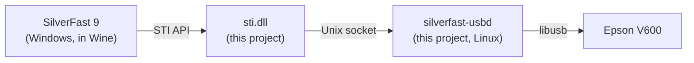

<div align="center">

# silverfast-linux

**Run SilverFast 9 on Linux and scan with your Epson Perfection V600 — no Windows VM required.**

[](https://github.com/sepgh/silverfast-linux/actions/workflows/ci.yml)


[](LICENSE)

[Quick start](#quick-start) · [How it works](#how-it-works) · [Troubleshooting](#troubleshooting) · [Roadmap](#roadmap) · [Docs](docs/)

</div>

---

[SilverFast](https://www.silverfast.com) is LaserSoft Imaging's scanner
software, popular for film and photo scanning. It is only available for
Windows and macOS. silverfast-linux runs the **Windows build of SilverFast 9
under Wine** and supplies the two pieces Wine is missing to reach a scanner: a
working Windows still-image layer (`sti.dll`) and a small Linux helper that
talks to the scanner over USB.

> [!NOTE]
> This is an unofficial community project. It is not affiliated with or
> endorsed by LaserSoft Imaging or Seiko Epson. You need your own SilverFast
> licence (MySilverFast account); nothing from either vendor is included in
> this repository — the installer downloads it from them.

## What works

| | |
|---|---|
| SilverFast 9 UI, MySilverFast login | ✅ |
| Scanner detection, firmware loading | ✅ automatic, on every power-on |
| Prescan | ✅ |
| Full scans | ✅ tested at 1600 dpi, 48-bit, 261 MB with zero USB errors |
| Scanner | Epson Perfection V600 Photo (`04b8:013a`) |
| SilverFast edition | Whatever your MySilverFast account unlocks (tested with SE) |
| Tested on | Fedora 43, Wine 11 |

Other scanners are not supported yet — see the [roadmap](#roadmap).

## Quick start

**1. Install the prerequisites**

| Distribution | Command |
|---|---|
| Fedora | `sudo dnf install wine 7zip curl python3 libusb1` |
| Debian / Ubuntu | `sudo apt install wine64 p7zip-full curl python3 libusb-1.0-0` |
| Arch | `sudo pacman -S wine 7zip curl python libusb` |

Building also needs a C compiler, libusb headers and MinGW — or just
`podman`/`docker`, see [step 2](#2-build).

**2. Build**

```sh
git clone https://github.com/sepgh/silverfast-linux.git
cd silverfast-linux
make            # or: make container   (builds inside podman/docker, no compilers needed)
make install    # installs to ~/.local (bin/silverfast-linux, lib/silverfast-linux/)
```

**3. Install SilverFast and the scanner support**

```sh
silverfast-linux install --accept-vendor-licenses
```

This creates a dedicated Wine prefix, downloads SilverFast 9 from LaserSoft and
the V600 driver from Epson, verifies every file, and registers the scanner.
Downloads are about 260 MB; the result needs about 1.1 GB.

**4. Allow your user to access the scanner** (once, needs root)

```sh
silverfast-linux udev    # prints the two commands to run
```

Then unplug and replug the scanner.

**5. Scan**

```sh
silverfast-linux run     # or start "SilverFast 9" from your application menu
```

Log in with your MySilverFast account, pick **Epson V600 / GT-X820**, press
**START**. On the first launch SilverFast asks you to choose a dark or light
look.

Check your setup any time with:

```sh
silverfast-linux doctor
```

## How it works



- **`sti.dll`** replaces Wine's stub. It tells SilverFast which scanners exist
  (with the exact details SilverFast checks for) and passes SilverFast's raw
  scanner reads and writes to the helper.
- **`silverfast-usbd`** owns the USB device on the Linux side. It uploads the
  V600's firmware when the scanner was just switched on (exactly what Epson's
  Windows driver does), and moves data in whole USB packets, which the V600
  needs.
- **`silverfast-linux`** installs everything into its own Wine prefix and
  starts the helper together with SilverFast.

SilverFast talks to the V600 through Epson's own protocol interpreter
(`esxuina1.dll`), which the installer takes from Epson's official driver
package along with the firmware.

The full story — what SilverFast expects, how the firmware upload works, and
why the project is designed this way — is in
**[docs/how-it-works.md](docs/how-it-works.md)**.

### Why not just use a Windows VM?

A VM works, but needs a Windows licence, 30–40 GB of disk and USB
passthrough. silverfast-linux needs about 1 GB and runs SilverFast as a normal
desktop application.

## Usage

| Command | What it does |
|---|---|
| `silverfast-linux install --accept-vendor-licenses` | Set up or repair the installation. Safe to re-run; downloads are cached. |
| `silverfast-linux run` | Start the USB helper and SilverFast. |
| `silverfast-linux doctor` | Check Wine, the installation, the scanner and its permissions. |
| `silverfast-linux udev` | Show how to grant USB access to the scanner. |
| `silverfast-linux uninstall [--purge]` | Remove the prefix (and with `--purge`, the download cache). |

**Where things live**

| Path | Contents |
|---|---|
| `~/.local/share/silverfast-linux/prefix` | The Wine prefix with SilverFast |
| `~/.local/share/silverfast-linux/firmware` | V600 firmware used by the helper |
| `~/.local/share/silverfast-linux/logs` | `usbd.log`, `sti.log`, `wine.log` |
| `~/.cache/silverfast-linux` | Downloaded vendor archives |

**Saving scans to your home folder:** in SilverFast's file dialogs, drive
`Z:` is your Linux root, so `Z:\home\<you>\Pictures` is your Pictures folder.

## Troubleshooting

<details>
<summary><b>"No Scanner available" in SilverFast</b></summary>

Run `silverfast-linux doctor`. Most often the scanner is off, or
`silverfast-linux install` was not run in the prefix you are starting.
</details>

<details>
<summary><b>"Problem communicating with your scanner"</b></summary>

- `doctor` says *scanner accessible ✗*: run `silverfast-linux udev` and follow it.
- Check `~/.local/share/silverfast-linux/logs/usbd.log` for `failed` lines.
- Switch the scanner off and on, then try again — the helper reloads the
  firmware automatically.
</details>

<details>
<summary><b>The scan stops halfway</b></summary>

Run `SFL_VERBOSE=1 silverfast-linux run`, reproduce, and open an issue with
`usbd.log` and SilverFast's `LogFile.txt` (path in
[docs/development.md](docs/development.md#debugging)).
</details>

<details>
<summary><b>SilverFast asks for the dark/light look on every start</b></summary>

Close SilverFast from its menu or window button instead of killing Wine; it
saves its preferences on a normal exit.
</details>

<details>
<summary><b>The installer reports a checksum mismatch</b></summary>

A vendor changed a file. For SilverFast this means a broken download — re-run
the install. For the Epson driver, open an issue: its hashes are pinned in
`scripts/silverfast-linux` and need updating.
</details>

## Roadmap

- **v1 (this release):** Epson Perfection V600, Linux helper + `sti.dll`.
- **Pure Wine:** a `usbscan.sys` driver so no helper process is needed and
  the work can go upstream into Wine.
- **More scanners:** model data files generated from Epson's drivers; other
  Epson flatbeds first.

Details: [docs/plans/future-pure-wine-and-more-scanners.md](docs/plans/future-pure-wine-and-more-scanners.md).
If you own another scanner and want to help test, please open an issue.

## Documentation

- [How it works](docs/how-it-works.md) — architecture, reverse-engineering findings, design decisions
- [Development](docs/development.md) — building, tests, debugging, layout
- [v1 design spec](docs/superpowers/specs/2026-10-27-silverfast-linux-v1-design.md)
- [Future plan](docs/plans/future-pure-wine-and-more-scanners.md)

## Contributing

Bug reports with logs, test reports from other distributions, and help with
the roadmap are welcome. Please run `make test` before sending changes.

## Legal

SilverFast is a trademark of LaserSoft Imaging AG. Epson and Perfection are
trademarks of Seiko Epson Corporation. silverfast-linux downloads their
software from their official servers on your machine; using it is subject to
their licence terms. This project contains only original code.

## License

The code in this repository is released under the [MIT License](LICENSE).
It does not cover SilverFast or Epson's software, which keep their own licences.
