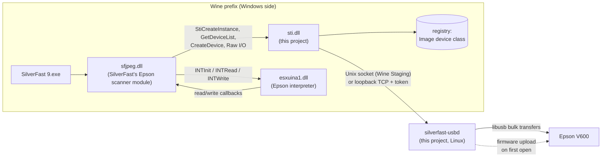

# How silverfast-linux works

This document explains what happens between SilverFast and your scanner, how
each piece was discovered, and why the project is built the way it is. If you
only want to scan, the [README](../README.md) is enough.

- [The problem](#the-problem)
- [Architecture](#architecture)
- [What SilverFast expects from Windows](#what-silverfast-expects-from-windows)
- [The V600 firmware upload](#the-v600-firmware-upload)
- [The USB helper](#the-usb-helper)
- [Installing SilverFast without its installer](#installing-silverfast-without-its-installer)
- [Design decisions](#design-decisions)
- [How the findings were made](#how-the-findings-were-made)

## The problem

SilverFast 9 only exists for Windows and macOS. Wine runs the program itself
well — the UI, the MySilverFast login and image processing all work out of the
box — but SilverFast never finds a scanner. Two things are missing:

1. **The Windows still-image (STI) layer.** SilverFast discovers and talks to
   scanners through `sti.dll`. Wine ships `sti.dll`, but its device list is an
   empty stub.
2. **The scanner driver stack.** On Windows, Epson's driver binds the scanner to
   `usbscan.sys` (the generic Windows USB scanner driver) and its WIA driver
   uploads firmware into the scanner when it is plugged in. Wine has neither
   `usbscan.sys` nor a way to run Epson's WIA driver.

## Architecture

| Piece | Runs on | Role |
|---|---|---|
| `sti.dll` | Wine | Lists the scanners registered in the prefix, creates `IStiDevice` objects and forwards their raw reads and writes to the helper. |
| `silverfast-usbd` | Linux | Owns the USB device through libusb, uploads firmware when needed, serves raw I/O over a Unix socket. |
| `silverfast-linux` | Linux | Installs everything into a dedicated Wine prefix and launches the helper together with SilverFast. |
| `esxuina1.dll`, `esfwa1.bin` | Wine / Linux | Epson's protocol interpreter and the V600 firmware, downloaded from Epson. |

## What SilverFast expects from Windows

SilverFast's scanner code lives in the large `sf*.dll` files next to the
executable; the Epson "interpreter" scanners such as the V600 are handled by
`sfjpeg.dll` (class `CsfScannerEpsonInt`). Its strings and imports are partly
obfuscated, so the requirements below were found by tracing it under Wine and
disassembling the relevant functions.

### Discovery

1. Every three seconds SilverFast calls `StiCreateInstanceW` and
   `IStillImage::GetDeviceList`.
2. For each entry it opens
   `HKLM\SYSTEM\CurrentControlSet\Control\Class\{6BDD1FC6-810F-11D0-BEC7-08002BE2092F}\NNNN`
   and reads:
   - `DeviceID` — must equal the device's internal STI name
     (`{6BDD1FC6-…}\NNNN`). Without it the device is silently ignored.
   - `MatchingDeviceId` — `usb\vid_04b8&pid_013a`; the USB IDs select the
     scanner model (shown as "Epson V600 / GT-X820").

On a real Windows system the STI class installer writes these values when the
Epson driver is installed. Under Wine, `silverfast-linux install` writes them.

### Opening the scanner

When you press START, `sfjpeg.dll` loads `STI.DLL` and looks up the
**undecorated** export `StiCreateInstance` by name. A `sti.dll` without that
export makes SilverFast jump to a null pointer. It then calls `GetDeviceList`
again and only accepts an entry if:

- `dwSize == 0x138` (the size of `STI_DEVICE_INFORMATIONW` on x64), and
- the high word of `DeviceType` is 1 (`StiDeviceTypeScanner`). STI packs the
  value as `MAKELONG(subtype, type)`, so a flatbed is `0x00010001`.

Failing either check produces SilverFast's "Lock failed!" error. After that it
calls `CreateDevice`, `LockDevice`, and does all communication with
`RawWriteData` / `RawReadData`, then `UnLockDevice` and `Release`.

### The Epson interpreter

The V600 does not speak Epson's ESC/I command language natively. Epson ships a
host-side "interpreter" (`esxuina1.dll` for x64) that translates ESC/I into the
scanner's low-level protocol. SilverFast loads it from `system32` (falling back
from a hard-coded Windows driver-store path), calls `INTInit(read_cb, write_cb)`
and then sends ESC/I through `INTWrite`/`INTRead`. The callbacks end up in
`IStiDevice::RawReadData`/`RawWriteData`, chunked to at most 0xFFFF bytes.

## The V600 firmware upload

The V600 boots without operational firmware and needs it uploaded into RAM
after every power-on. SilverFast does not do this; on Windows, Epson's WIA
driver (`esxw2ud.dll`) does it when the scanner is plugged in. Without it,
SilverFast fails with "Can't write exStatusCommand".

The sequence below is taken from `CWIADriver::InitScanner` and
`CWIADriver::DownLoadFirmware` in that driver:

1. **Check.** Send `1b 03`, read 2 bytes. If bit `0x10` of the first byte is set,
   firmware is already running (we observed `28 00` before and `18 01` after
   the upload).
2. **Prepare.** Read `esfwa1.bin`, drop its 256-byte `EDLA` header. Replace the
   last byte of the remaining payload with the 8-bit sum of all bytes before it.
3. **Upload.**
   - send `1b 06`, expect ACK `06`
   - send the payload size as a little-endian u32
   - send the payload except its last byte in chunks of 0xFFF0 bytes
   - send the checksum byte, expect `06`
   - send `1b 16`, expect `06`
   - send `80`, expect `06`

This only writes to the scanner's RAM; nothing is flashed. It is implemented in
`helper/src/firmware.c` and unit-tested against a scripted fake device.

## The USB helper

`silverfast-usbd` is a small C program on top of libusb. It:

- opens the first supported scanner (`helper/src/models.h`), claims interface 0
  and runs the firmware check/upload;
- serves one client at a time on two endpoints, both in or announced through
  a `0700` directory under `$XDG_RUNTIME_DIR/silverfast-linux/`:
  - a Unix socket (`usbd.sock`), used by Wine Staging, which supports
    `AF_UNIX`;
  - a loopback TCP port on `127.0.0.1` (written to `usbd.port`), used by
    mainline Wine, which does not support `AF_UNIX`;
- requires a per-session random token (`usbd.token`, mode `0600`) in the first
  message of every connection. The launcher creates it and passes it to Wine in
  `SFL_USBD_TOKEN`; without it, other local users could reach the TCP port;
- reads in whole 512-byte packets. SilverFast asks for exact byte counts, but
  the V600 sometimes sends more than requested; an exact-size bulk read then
  fails with an overflow error and, after enough errors, the scanner resets
  itself. Surplus bytes are kept in a buffer for the next request
  (`helper/src/rxbuf.c`);
- reopens the scanner (and re-uploads firmware) if it disappears from the bus.

The wire protocol is in `helper/src/protocol.h`: a 5-byte header
(`op`, little-endian length), then the payload; every request gets an 8-byte
reply (status as negative errno, length) followed by data. The first request
must be `HELLO` with `SFL1` followed by the token.

## Installing SilverFast without its installer

LaserSoft's online installer is a Qt Installer Framework program. Under Wine it
hangs at the first download, so `silverfast-linux install` does its job
directly:

1. Read the release index (`https://cdn9.silverfast.com/release/sf9/win/Updates.xml`),
   which points to the current versioned repository.
2. Read that repository's `Updates.xml` and pick the components listed in
   `scripts/components.txt`.
3. Download each archive, verify it against the `.sha1` LaserSoft publishes
   next to it, and extract it to the folder LaserSoft's own install scripts
   use (program folder, `C:\ProgramData\LaserSoft Imaging\SilverFast 9\…`, or
   the colour profile folder). SilverFast refuses to start ("Important folders
   are missing") if this layout is incomplete.
4. Install the bundled Visual C++ runtime and the `HKLM\SOFTWARE\LaserSoft
   Imaging\SilverFast 9` values (`x64_path`, `x64_Version`, `x64_Stamp`) that
   the real installer writes.

The SilverFast build is the same for every edition; your MySilverFast account
decides whether it runs as SE, SE Plus, Ai Studio or demo.

## Design decisions

**Wine instead of a Windows VM.** A VM would run Epson's real drivers, but
needs 30–40 GB of disk, a Windows licence and USB passthrough. The goal is
something anyone can install, so the project fills the two gaps in Wine
instead.

**Replace `sti.dll` rather than emulate `usbscan.sys`.** SilverFast only uses
the STI raw I/O calls, so implementing them directly avoids writing a Windows
kernel driver and getting Wine to bind it to the device. A `usbscan.sys` route
is still attractive long-term because it would let Epson's own drivers run
unchanged; it is planned in
[future-pure-wine-and-more-scanners.md](plans/future-pure-wine-and-more-scanners.md).
`sti.dll` keeps its USB access behind `sti/src/transport.c` so that route can
replace the helper without touching the rest.

**A native Linux helper over a Unix socket.** A Windows DLL cannot call libusb
directly, and building a Wine-internal "unixlib" DLL ties the project to Wine's
internal build system and versions. A separate process talking over a socket
works with any Wine ≥ 9 from any distribution. Wine Staging supports
`AF_UNIX` sockets with plain Unix paths; mainline Wine does not (the support
is a Staging patch set), so the helper also listens on loopback TCP. A random
per-session token stops other local users from using that port. `sti.dll`
tries the Unix socket first and falls back to TCP.

**Upload the firmware ourselves.** Running Epson's WIA driver would require the
whole WIA service under Wine. The upload is short and well understood, so the
helper performs it — the same bytes Epson's driver sends.

**Download vendor files at install time.** Neither SilverFast nor Epson's files
may be redistributed. The installer fetches them from the vendors and verifies
them: SilverFast against LaserSoft's published SHA-1s, the Epson driver and the
two files taken from it against pinned SHA-256s.

**A dedicated Wine prefix.** SilverFast, the `sti.dll` override and the device
registration stay out of your other Wine prefixes.

## How the findings were made

The investigation used only observation of the vendor software running under
Wine and disassembly of the specific functions involved:

- a logging stand-in `sti.dll` showed which STI calls SilverFast makes and with
  what arguments;
- Wine's `+relay` and `+file` traces showed registry and file access;
- disassembly of `sfjpeg.dll` around the "Lock failed!" message revealed the
  `dwSize`/`DeviceType` checks;
- disassembly of Epson's `esxw2ud.dll` (`InitScanner`, `DownLoadFirmware`)
  revealed the firmware check and upload sequence;
- a throwaway libusb bridge verified each step against the real scanner, up to
  a 1600 dpi, 16-bit-per-channel scan of 261 MB with no transfer errors.
